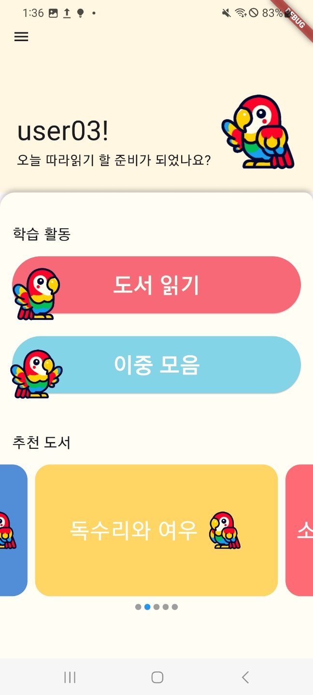
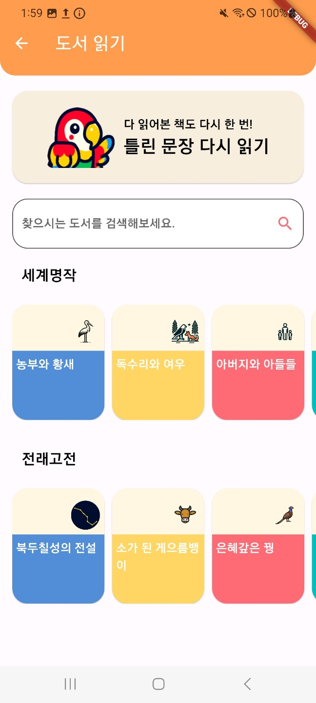
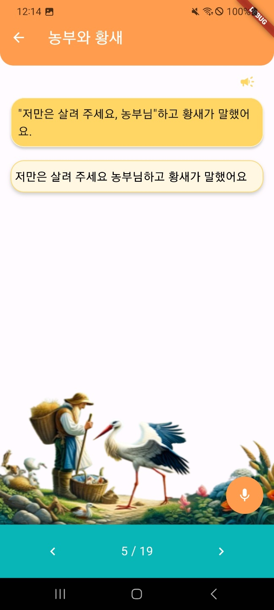
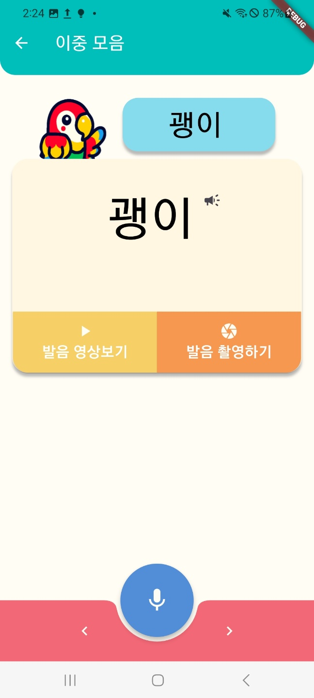
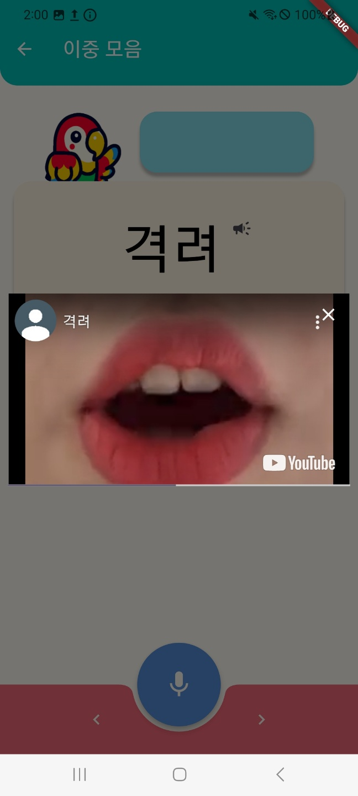
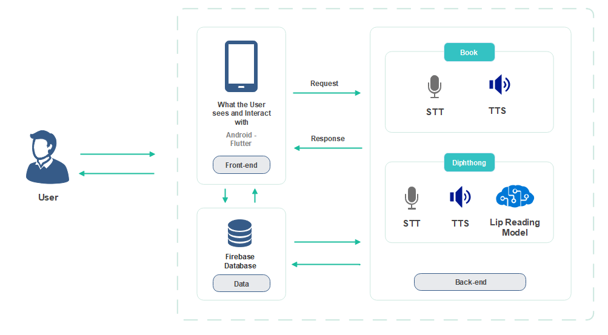

# 도드다 (Dodda)

**조잘조잘** 팀이 만든 영유아 한국어 발음 학습 모바일 앱입니다. 동화 문장과 이중모음 단어를 듣고 따라 읽은 뒤, 음성 인식 결과를 기준 문장과 비교해 발음 연습을 할 수 있도록 돕습니다.

> 프로젝트 문제의식: 코로나19 이후의 미디어 환경 변화 등으로 영유아 언어 발달에 대한 관심이 커졌습니다. 도드다는 아이들이 놀이처럼 문장과 단어를 반복해서 듣고 말하며 발음을 연습할 수 있는 모바일 학습 환경을 목표로 합니다.

## 팀 구성

| 이름 | 역할 |
| --- | --- |
| 김동영 | PM · 프론트엔드 |
| 구강현 | 백엔드 · STT |
| 권유경 | AI |
| 김채현 | 백엔드 · TTS |
| 장혜진 | 데이터베이스 |

## 주요 기능

- **동화 읽기**: 장르별 동화 목록과 검색으로 책을 고르고, 문장·삽화를 보며 페이지별로 읽습니다.
- **발음 확인**: 마이크로 말한 문장을 STT로 받아 기준 문장과 비교합니다. 문장부호를 정규화하고 띄어쓰기 단위로 비교해 맞은 부분은 검은색, 다른 부분은 빨간색으로 표시합니다.
- **이중모음 연습**: 이중모음이 포함된 단어를 차례로 연습하고, 기준 음성을 듣거나 발음 영상을 보며 따라 할 수 있습니다.
- **다시 읽기·복습**: 읽던 위치와 학습 결과를 저장하고, 틀린 문장을 다시 연습할 수 있습니다.
- **계정 및 학습 데이터**: Firebase Authentication으로 계정을 관리하고 Cloud Firestore에서 동화·단어·사용자별 학습 정보를 불러오고 저장합니다.
- **음성 출력**: `flutter_tts`로 한국어 기준 단어와 문장을 재생합니다.

## 화면 소개

| 화면 | 설명 |
| --- | --- |
| **홈 화면**<br> | 사용자 인사말과 함께 동화 읽기·이중모음 학습으로 이동하고 추천 도서를 볼 수 있습니다. |
| **동화책 목록**<br> | 장르별 책을 탐색하고 검색할 수 있습니다. 틀린 문장 다시 읽기 메뉴로 복습을 시작합니다. |
| **동화 읽기 — 일치**<br> | 기준 문장을 듣고 마이크로 읽습니다. 인식 결과가 기준 문장과 일치하는 예시입니다. |
| **동화 읽기 — 불일치**<br> | 기준 문장과 다른 어절을 빨간색으로 표시해 아이가 차이를 알아볼 수 있습니다. |
| **이중모음 단어 연습**<br> | 연습할 단어와 마이크 버튼, 앞·뒤 단어 이동 버튼을 제공합니다. |
| **입 모양 참고 영상**<br> | 단어별 발음 참고 영상을 앱 안에서 재생할 수 있습니다. |

## 시스템 아키텍처

아래 그림은 프로젝트 제안 자료에 포함된 전체 구상도입니다.

<p align="center">
  
</p>

그림에는 동화·이중모음 학습, STT·TTS, 입 모양 읽기 모델, Firebase 데이터베이스가 표시되어 있습니다. 현재 저장소의 Flutter 앱 코드에서는 `speech_to_text` 기반 STT, `flutter_tts` 기반 음성 출력, Firebase 연동 및 입 모양 참고 영상 재생을 확인할 수 있습니다. **MobileNet+LSTM 모델의 학습·추론 코드나 모델 파일은 이 저장소에 포함되어 있지 않습니다.**

## STT와 발음 비교

STT는 `speech_to_text` 패키지로 구현했습니다. `SpeechToTextProvider`가 음성 인식 결과를 보관하고, 새 결과가 도착할 때마다 `notifyListeners()`를 호출합니다. 학습 화면은 Provider의 `Consumer`를 통해 변경된 텍스트를 받아 UI를 갱신합니다.

비교 과정은 다음과 같습니다.

1. 마이크 입력을 음성 인식 결과 텍스트로 변환합니다.
2. 비교 전에 대소문자와 일부 문장부호를 정규화합니다.
3. 문장을 공백 기준으로 나누어 기준 문장과 인식 결과의 어절을 비교합니다.
4. 일치한 어절은 검은색, 다른 어절은 빨간색으로 표시합니다.
5. 문장 전체 일치 여부는 학습 결과 저장과 복습 흐름에 사용합니다.

관련 코드: [`lib/STT/stt.dart`](lib/STT/stt.dart), [`lib/STT/compareSentence.dart`](lib/STT/compareSentence.dart), [`lib/STT/compareText.dart`](lib/STT/compareText.dart)

## 기술 스택

- **앱**: Flutter, Dart
- **상태 관리**: Provider
- **음성 인식**: `speech_to_text`
- **음성 합성**: `flutter_tts`
- **동영상**: `youtube_player_flutter`
- **인증·데이터베이스**: Firebase Authentication, Cloud Firestore

## 실행 방법

Flutter SDK를 설치하고 저장소 루트에서 실행합니다.

```bash
flutter pub get
flutter run
```

앱을 실행하려면 Firebase 프로젝트 설정이 필요합니다. Android 앱은 `android/app/google-services.json`을 사용합니다. Firebase 데이터는 Authentication과 Firestore 보안 규칙에 맞게 구성해야 합니다.

## 저장소 구조

```text
lib/
├── 01_LoginPages/       # 로그인
├── 02_SignUpPages/      # 회원가입
├── 03_HomePages/        # 홈 및 학습 메뉴
├── 04_Vowel*/           # 이중모음 학습
├── 05_FairyTale*/       # 동화 탐색 및 읽기
├── 06_Review*/           # 오답 문장 복습
├── 07_Search/           # 도서 검색
├── 08_Setting/          # 설정
├── 09_LearningHistory/  # 학습 내역
├── STT/                 # 음성 인식 및 문장 비교
└── TTS/                 # 음성 합성
docs/images/             # README 화면 및 아키텍처 이미지
```
